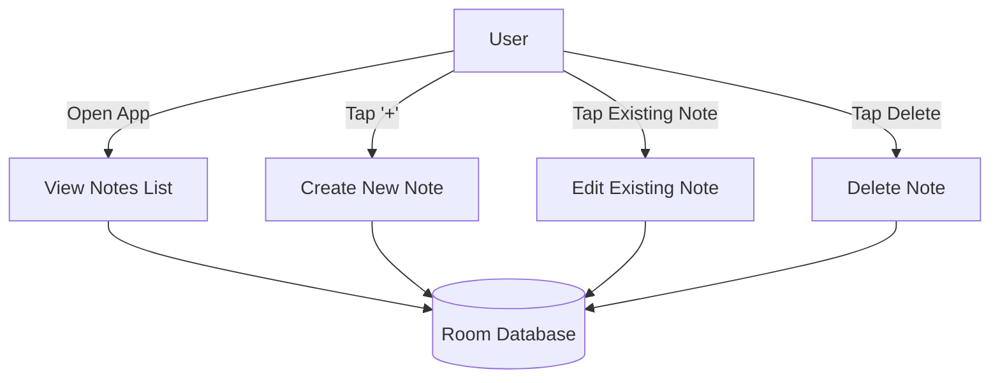
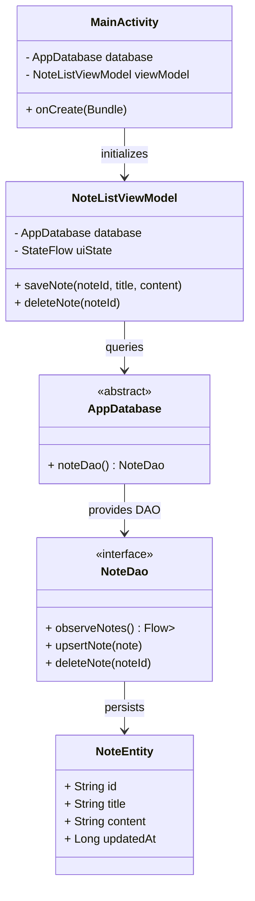
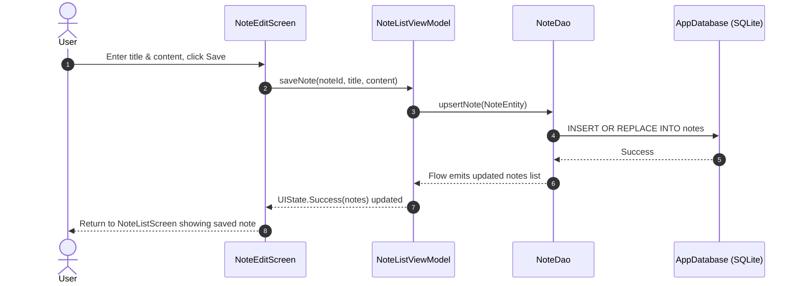

# Notes - Kotlin Multiplatform (KMP) Offline-First App

A cross-platform (Android & iOS) offline-first note-saving application built with modern Kotlin Multiplatform, Compose Multiplatform, and AndroidX Room KMP following Clean Architecture principles.

## 🚀 Tech Stack
- **Kotlin Multiplatform (KMP)**: Shared domain, data, and presentation logic.
- **Compose Multiplatform**: Declarative cross-platform UI adhering to Material 3 guidelines.
- **AndroidX Room KMP**: Local offline SQLite database with bundled SQLite driver.
- **Kotlinx Coroutines & Serialization**: Asynchronous execution and data serialization.

---

## 📊 System Diagrams & Architecture

### 1. Use Case Diagram

### 2. Class Diagram

### 3. Sequence Diagram (Note Creation & Editing Flow)

---

## 📂 Project Structure
- `shared/src/commonMain/kotlin/com/notes/app/data/local`: Room Database, Entity, and DAO definitions.
- `shared/src/commonMain/kotlin/com/notes/app/presentation`: ViewModels and Compose Multiplatform UI (`NoteListScreen`, `NoteEditScreen`).
- `androidMain` & `iosMain`: Platform-specific SQLite driver implementations.
- `.github/workflows`: Automated CI/CD workflows for building and testing.
